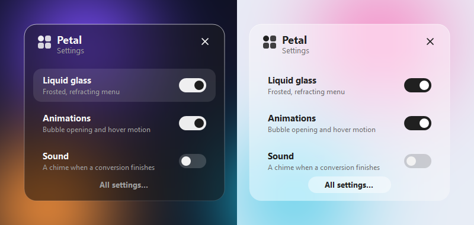
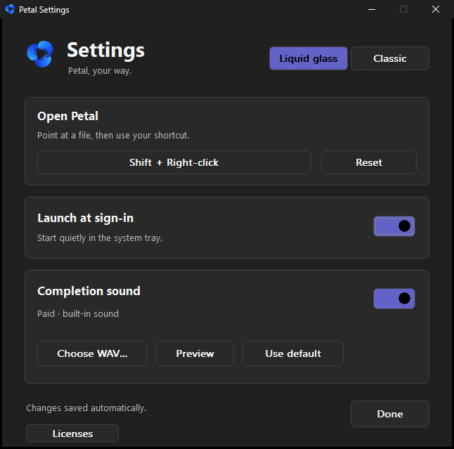

<p align="center"><a href="../../README.md">English</a> · <a href="README.zh-CN.md">简体中文</a> · <a href="README.es.md">Español</a> · <a href="README.ar.md">العربية</a> · <a href="README.hi.md">हिन्दी</a> · <strong>Français</strong></p>

<p align="center"></p>

# Petal

**Maj + clic droit sur un fichier. Choisis un format. C’est converti.**

Petal est un utilitaire natif pour Windows 11 qui place la conversion d’images, de fichiers audio, de vidéos et de documents texte dans un menu circulaire compact, directement dans l’Explorateur et sur le bureau. Son thème par défaut, **liquid glass**, dépoli et déforme ce qui se trouve derrière lui. Un thème **classique** reprend plutôt la couleur d’accentuation de Windows. Le bouton central ouvre toujours le menu contextuel Windows d’origine.

Cette page est en français. **L’interface de l’application est en anglais.**

## Aperçu


Rendu par le moteur natif de Petal sur un fond d’écran synthétique. [Création des visuels](../MEDIA.md) (en anglais).

## Fonctionnalités

- **Six choix pertinents.** Les formats s’adaptent au fichier ; son format actuel est remplacé par une autre proposition.
- **Images, audio, vidéos et documents.** Convertir en WebP, extraire une bande son, transformer un texte en PDF, et plus.
- **Liquid glass.** Les pétales et le centre sont en verre dépoli qui réfracte le bureau près de chaque bord. Au survol, le verre s’éclaire au lieu de se remplir de couleur.
- **Animation bulle.** Le centre apparaît d’abord, puis les pétales jaillissent de dessous avec un léger rebond, en moins d’une demi-seconde.
- **Retour clair.** Chargement visible, coche de validation, notification Windows avec le logo et son facultatif.
- **Natif et local.** Rust avec Win32/GDI+, sans moteur de navigateur ni envoi de fichiers. Le moteur audio/vidéo est un téléchargement unique et vérifié.

> **L’original reste intact.** Le fichier converti est vérifié puis enregistré dans le même dossier avec la nouvelle extension : `photo.jpg` → `photo.webp`. Petal n’écrase jamais un fichier existant. Les métadonnées et la mise en page de la copie convertie peuvent changer.

## Formats

| Fichier sélectionné | Choix par défaut | Alternative au format actuel |
| --- | --- | --- |
| Image | JPG · PNG · WebP · GIF · BMP · PDF | TIFF |
| Audio | MP3 · WAV · FLAC · M4A · OGG · MP4 | OPUS |
| Vidéo | MP4 · MKV · WebM · MOV · MP3 · WAV | AVI |
| Document texte | TXT · DOCX · MD · HTML · RTF · PDF | ODT |

Audio → MP4 crée une vidéo avec un fond noir et le son du fichier. Vidéo → MP3 extrait la piste audio. Les conversions de documents conservent le texte et les paragraphes, plutôt que la mise en page. Les PDF numérisés nécessitent un OCR et sont refusés. Voir les [formats et limites](../../FORMATS.md) (en anglais).

## Installation

**Configuration requise : Windows 11 x64.**

### Télécharger v1.2.1

Télécharge **[Petal.exe](https://github.com/Syawi/Petal/releases/download/v1.2.1/Petal.exe)** et lance-le directement. Aucun ZIP, dossier de ressources, accès administrateur ni installation d’Office n’est nécessaire.

Le logo, le son et les licences sont intégrés. Les petits fichiers de fonctionnement sont créés dans `%LOCALAPPDATA%/Petal`. À la première conversion audio/vidéo, Petal télécharge et vérifie automatiquement le moteur FFmpeg (environ 109 Mo). Les conversions suivantes fonctionnent hors ligne ; les images et documents n’en ont jamais besoin.

Le lancement au démarrage est activé au premier lancement et peut être désactivé dans les **réglages**. Garde l’exécutable à un emplacement stable pour qu’il continue de fonctionner.

### Compiler les sources

Installe [Rust](https://rustup.rs/) ainsi que les outils de compilation Visual Studio C++ et le SDK Windows pour MSVC, puis :

```powershell
git clone https://github.com/Syawi/Petal.git
cd Petal
./Build.ps1
./Petal.exe
```

Le script prépare les outils de test FFmpeg/FFprobe, exécute les tests et crée l’exécutable. Pour GNU, consulte [CONTRIBUTING.md](../../CONTRIBUTING.md).

## Utilisation

1. Lance `Petal.exe`. Son icône bleue apparaît dans la zone de notification, parfois parmi les icônes masquées.
2. Maintiens **Maj** et fais un clic droit sur un fichier compatible dans l’Explorateur ou sur le bureau.
3. Clique sur un format. Petal crée et vérifie la copie, puis affiche **Conversion complete**.

Le clic droit seul ouvre toujours le menu Windows, tout comme le centre de la roue (le logo Windows). Clique en dehors ou appuie sur **Échap** pour masquer la roue ; une conversion en cours continue en arrière-plan.

| Raccourci | Action |
| --- | --- |
| `1`–`6` | Choisir le pétale correspondant |
| `Tab`, puis `Entrée` / `Espace` | Sélectionner et activer une option |
| `M` | Ouvrir le menu Windows |
| `Échap` | Masquer la roue ou l’animation |

## Thèmes


| Thème | Surfaces | Survol |
| --- | --- | --- |
| **Liquid glass** (par défaut) | Verre dépoli qui réfracte ce qu’il y a derrière le menu. Incolore : toutes les teintes viennent de ton bureau. | Le verre s’éclaire d’un reflet blanc et d’un liseré plus brillant ; le texte reste lisible. |
| **Classique** | Surfaces opaques de Windows 11. | Le pétale prend exactement la couleur d’accentuation de Windows et son texte devient noir. |

Les deux suivent le mode clair/sombre de Windows. Le liquid glass capture l’arrière-plan à l’ouverture de la roue : un contenu en mouvement derrière, comme une vidéo, ne se met pas à jour tant que la roue est affichée.

## Réglages

Petal propose deux surfaces de réglages, accessibles depuis son icône de notification. Chaque changement est enregistré immédiatement : il n’y a pas de bouton Appliquer.

### Réglages rapides



**Clic gauche** sur l’icône de notification : un panneau en verre apparaît en bulle au-dessus.

| Interrupteur | Effet |
| --- | --- |
| **Liquid glass** | Active le thème verre, ou revient au thème classique. |
| **Animations** | Ouverture en bulle, mouvement des pétales au survol et animations de retour. C’est un réglage propre à Petal : il reste actif même si les *effets d’animation* de Windows sont désactivés. |
| **Sound** | Le son joué avec la coche de validation. |

**All settings…** ouvre la fenêtre complète. Ferme le panneau avec **Échap**, le bouton **×** ou un clic ailleurs. Les flèches ou **Tab** passent d’un interrupteur à l’autre, **Espace** ou **Entrée** l’active.

### Tous les réglages



Ouvre-la avec **All settings…** dans le panneau rapide, ou fais un **clic droit** sur l’icône et choisis **Settings…**.

| Section | Contrôles |
| --- | --- |
| **Thème** (en haut à droite) | **Liquid glass** ou **Classic** pour la roue. |
| **Open Petal** | Clique sur le bouton du raccourci, puis appuie sur n’importe quelle touche ou bouton de souris, avec Ctrl, Maj, Alt ou Windows en option. **Échap** annule. Les raccourcis clavier agissent sur le fichier sous le pointeur quand l’Explorateur ou le bureau est au premier plan. Windows peut réserver certaines combinaisons. **Reset** rétablit Maj + clic droit. |
| **Launch at sign-in** | Lance Petal discrètement dans la zone de notification à l’ouverture de session. Activé après le premier lancement. |
| **Completion sound** | Active ou coupe le son. **Choose WAV…** choisit ton propre fichier WAV, **Preview** joue le son actuel et **Use default** revient au son intégré *Paid*. Si le fichier choisi disparaît, Petal reprend le son intégré. |
| **Licenses** | Ouvre les mentions des composants tiers intégrées à Petal.exe. |

### Menu de l’icône

| Action | Résultat |
| --- | --- |
| Clic gauche sur l’icône | Réglages rapides |
| Clic droit → **Mute sound** | Coupe ou rétablit le son |
| Clic droit → **Settings…** | La fenêtre de réglages complète |
| Clic droit → **Quit Petal** | Quitte Petal. Indisponible pendant une conversion. |

Les réglages sont enregistrés par utilisateur dans `HKEY_CURRENT_USER\Software\Petal`. Le lancement au démarrage utilise la clé `Run` standard. Aucun droit administrateur n’est nécessaire.

## Développement

```powershell
./Install-MediaEngine.ps1
cargo fmt --check
cargo test --locked
cargo build --release --locked
```

La CI Windows vérifie le formatage, exécute les tests et compile l’exécutable. Les vérifications du bureau interactif et l’export des visuels du README sont facultatifs. Documentation technique en anglais : [tests](../../TESTING.md), [contribution](../../CONTRIBUTING.md), [design](../../DESIGN.md), [visuels](../MEDIA.md).

## Licence et crédits

[Licence MIT](../../LICENSE), copyright © 2026 Syawi. Les dépendances et ressources conservent leurs licences : [mentions tierces](../../THIRD_PARTY_NOTICES.md), [ressources](../../assets/SOURCES.md), [moteur multimédia](../../ffmpeg/SOURCES.md).
