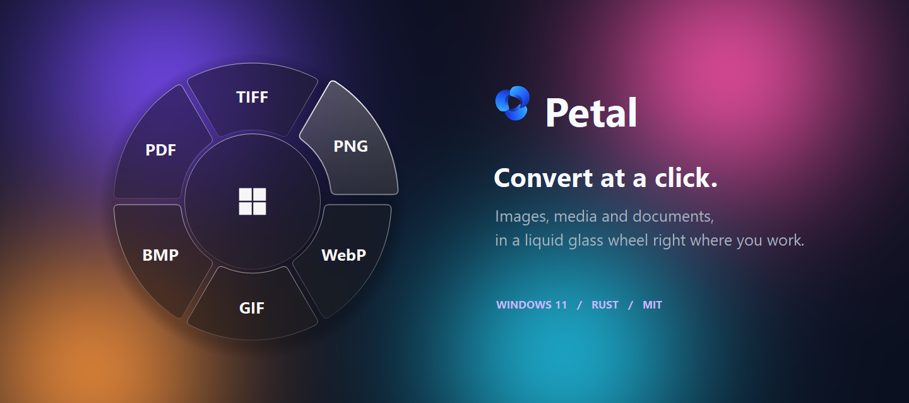
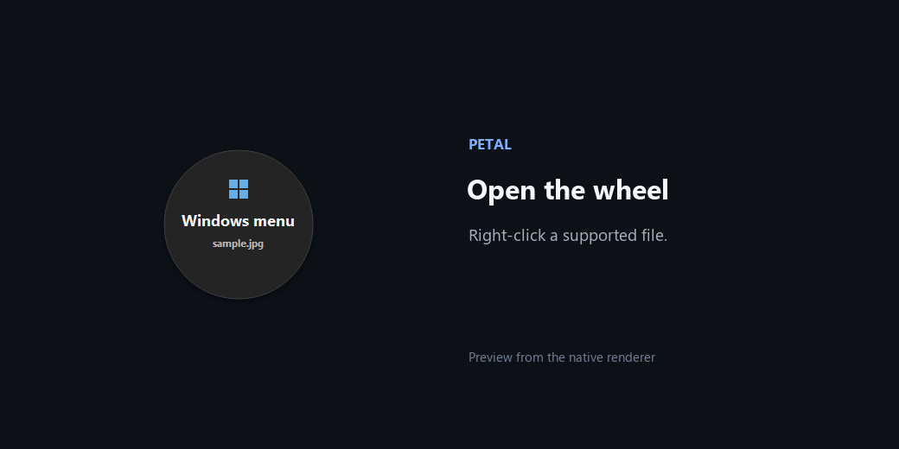
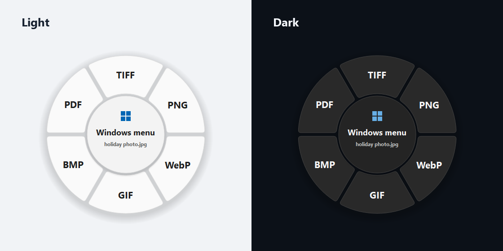

<p align="center"><a href="../../README.md">English</a> · <a href="README.zh-CN.md">简体中文</a> · <a href="README.es.md">Español</a> · <a href="README.ar.md">العربية</a> · <strong>हिन्दी</strong> · <a href="README.fr.md">Français</a></p>

<p align="center"></p>

# Petal

**फ़ाइल पर राइट-क्लिक करें। फ़ॉर्मैट चुनें। रूपांतरण पूरा।**

Petal, Windows 11 के लिए एक नेटिव टूल है। इसके छोटे गोलाकार मेनू से तस्वीरों, ऑडियो, वीडियो और टेक्स्ट दस्तावेज़ों को दूसरे फ़ॉर्मैट में बदला जा सकता है। यह फ़ाइल एक्सप्लोरर और डेस्कटॉप, दोनों में काम करता है, Windows की थीम और एक्सेंट रंग अपनाता है और बीच के बटन से Windows का मूल राइट-क्लिक मेनू खोलता है।

यह पृष्ठ हिंदी में है। **ऐप का इंटरफ़ेस अभी अंग्रेज़ी में है।**

## झलक



यह झलक नेटिव रेंडरर और एक उदाहरण फ़ाइल नाम से बनाई गई है। [दृश्य सामग्री कैसे बनती है](../MEDIA.md) (अंग्रेज़ी में)।

## सुविधाएँ

- फ़ाइल के अनुसार अधिकतम छह विकल्प; मौजूदा फ़ॉर्मैट की जगह दूसरा विकल्प दिखता है।
- तस्वीरों, ऑडियो, वीडियो और टेक्स्ट दस्तावेज़ों का स्थानीय रूपांतरण; फ़ाइलें अपलोड नहीं होतीं।
- हल्की और गहरी थीम, Windows एक्सेंट रंग, हिलती पंखुड़ियाँ और कम एनीमेशन की सेटिंग का समर्थन।
- लोडिंग संकेत, सफलता का चिह्न, लोगो वाली Windows सूचना और बंद की जा सकने वाली ध्वनि।
- Rust और Win32/GDI+ से बना नेटिव ऐप; ब्राउज़र रनटाइम की ज़रूरत नहीं।

> **मूल फ़ाइल जस की तस रहती है।** Petal नतीजे की जाँच करके उसी फ़ोल्डर में नए एक्सटेंशन के साथ एक कॉपी बनाता है: `photo.jpg` → `photo.webp`। पहले से मौजूद फ़ाइल को कभी ओवरराइट नहीं किया जाता। नई कॉपी के मेटाडेटा या लेआउट में बदलाव हो सकता है।

## फ़ॉर्मैट

| चुनी गई फ़ाइल | सामान्य विकल्प | मौजूदा फ़ॉर्मैट का विकल्प |
| --- | --- | --- |
| तस्वीर | JPG · PNG · WebP · GIF · BMP · PDF | TIFF |
| ऑडियो | MP3 · WAV · FLAC · M4A · OGG · MP4 | OPUS |
| वीडियो | MP4 · MKV · WebM · MOV · MP3 · WAV | AVI |
| टेक्स्ट दस्तावेज़ | TXT · DOCX · MD · HTML · RTF · PDF | ODT |

ऑडियो → MP4 में काली पृष्ठभूमि और फ़ाइल की आवाज़ वाला वीडियो बनता है। वीडियो → MP3 में ऑडियो ट्रैक निकाला जाता है। दस्तावेज़ का टेक्स्ट और पैराग्राफ़ सुरक्षित रहते हैं, मूल लेआउट नहीं। स्कैन किए हुए PDF के लिए OCR चाहिए; उन्हें स्वीकार नहीं किया जाता। [फ़ॉर्मैट और सीमाएँ](../../FORMATS.md) अंग्रेज़ी में उपलब्ध हैं।

## शुरू करें

**आवश्यकता: Windows 11 x64।**

### v1.2 डाउनलोड करें

**[Petal.exe](https://github.com/Syawi/Petal/releases/download/v1.2/Petal.exe)** डाउनलोड करके Windows 11 x64 पर सीधे चलाएँ। ZIP, संसाधन फ़ोल्डर, एडमिन अधिकार या Office की ज़रूरत नहीं है।

लोगो, ध्वनि और लाइसेंस ऐप में शामिल हैं। रनटाइम फ़ाइलें `%LOCALAPPDATA%/Petal` में रहती हैं। पहले ऑडियो/वीडियो रूपांतरण पर FFmpeg इंजन (लगभग 109 MB) अपने आप डाउनलोड और सत्यापित होता है; उसके बाद रूपांतरण ऑफ़लाइन चलता है। तस्वीरों और दस्तावेज़ों को इस डाउनलोड की ज़रूरत नहीं है।

पहले लॉन्च पर Windows के साथ शुरू होना चालू रहता है; इसे **Settings** में बंद कर सकते हैं। executable को स्थिर स्थान पर रखें। लाइसेंस **Settings → Licenses** में हैं।

### स्रोत से बिल्ड करें

[Rust](https://rustup.rs/), Visual Studio C++ build tools और MSVC के लिए Windows SDK इंस्टॉल करें, फिर:

```powershell
git clone https://github.com/Syawi/Petal.git
cd Petal
./Build.ps1
./Petal.exe
```

स्क्रिप्ट FFmpeg/FFprobe तैयार करती है, डाउनलोड के SHA-256 की जाँच करती है, टेस्ट चलाती है और executable बनाती है। GNU की जानकारी [CONTRIBUTING.md](../../CONTRIBUTING.md) में अंग्रेज़ी में है।

## मेनू का इस्तेमाल

1. `Petal.exe` चलाएँ। सिस्टम ट्रे में नीला आइकन दिखेगा; वह छिपे हुए आइकन वाले हिस्से में भी हो सकता है।
2. **Shift** दबाकर एक्सप्लोरर या डेस्कटॉप की किसी समर्थित फ़ाइल पर राइट-क्लिक करें।
3. फ़ॉर्मैट चुनें। Petal कॉपी बनाकर जाँचता है और **Conversion complete** दिखाता है।

बीच का **Windows menu** बटन मूल मेनू खोलता है। सामान्य राइट-क्लिक से Windows मेनू खुलता है। डिफ़ॉल्ट **Shift + राइट-क्लिक** से Petal खुलता है; इसे बदल सकते हैं। बाहर क्लिक करने या **Esc** दबाने से मेनू छिप जाता है; चल रहा रूपांतरण पृष्ठभूमि में जारी रहता है।

| शॉर्टकट | काम |
| --- | --- |
| `1`–`6` | संबंधित पंखुड़ी से रूपांतरण |
| `Tab`, फिर `Enter` / `Space` | विकल्प चुनना और सक्रिय करना |
| `M` | Windows संदर्भ मेनू खोलना |
| `Esc` | मेनू या संकेत छिपाना |

ट्रे से **Settings…** खोलकर कोई कुंजी या माउस बटन और Ctrl/Shift/Alt/Win संयोजन रिकॉर्ड करें, Windows के साथ शुरू होना बदलें या WAV ध्वनि चुनकर सुनें। बदलाव अपने आप सेव होते हैं; **Reset** से Shift + राइट-क्लिक वापस आता है।

ट्रे आइकन के मेनू में **Mute sound** से ध्वनि बंद करें और **Quit Petal** से ऐप बंद करें। ध्वनि की सेटिंग याद रहती है। रूपांतरण के दौरान ऐप बंद करने का विकल्प उपलब्ध नहीं होता।

## रूप और विकास



होवर करने पर पंखुड़ी या बीच का बटन एक्सेंट रंग अपनाता है और टेक्स्ट काला हो जाता है। कम एनीमेशन की सेटिंग में गति बंद रहती है और स्थिर संकेत दिखते हैं।

```powershell
./Install-MediaEngine.ps1
cargo fmt --check
cargo test --locked
cargo build --release --locked
```

Windows CI फ़ॉर्मैट जाँचता है, टेस्ट चलाता है और ऐप बिल्ड करता है। इंटरैक्टिव डेस्कटॉप जाँच और README फ़्रेम एक्सपोर्ट वैकल्पिक हैं। अंग्रेज़ी तकनीकी दस्तावेज़: [टेस्ट](../../TESTING.md), [योगदान](../../CONTRIBUTING.md), [दृश्य सामग्री](../MEDIA.md)।

## लाइसेंस और श्रेय

[MIT लाइसेंस](../../LICENSE), कॉपीराइट © 2026 Syawi। तीसरे पक्ष के टूल और संसाधन अपने लाइसेंस के अधीन हैं: [सूचनाएँ](../../THIRD_PARTY_NOTICES.md), [संसाधनों के स्रोत](../../assets/SOURCES.md), [मीडिया इंजन के स्रोत](../../ffmpeg/SOURCES.md)।
